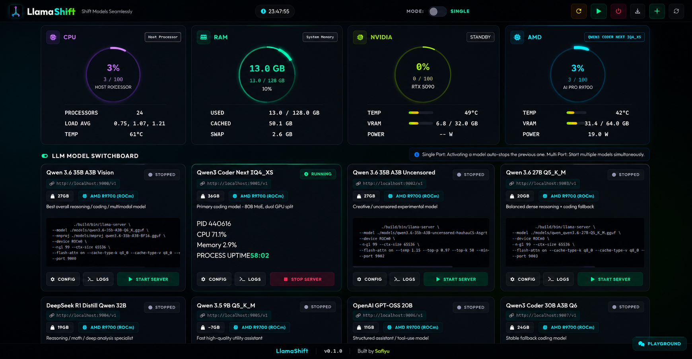

# LlamaShift

**Llama Model Manager** — A powerful, GPU-aware web-based control panel for managing multiple local Llama models with seamless switching between single-port and multi-port modes.


---

## Overview

LlamaShift is a comprehensive LLM model management platform that enables users to run, switch between, and monitor multiple local Llama models through an intuitive web interface. Built on Flask and powered by llama.cpp, LlamaShift provides seamless model switching with GPU acceleration support for both NVIDIA CUDA and AMD ROCm devices.

### Key Capabilities

- **Single-Port Mode**: Run one model at a time on a shared port — ideal for integration with Open WebUI and other LLM frontends that expect a single endpoint.
- **Multi-Port Mode**: Host multiple models simultaneously, each on its own dedicated port, enabling parallel inference workloads.
- **GPU-Aware Management**: Auto-detects NVIDIA CUDA and AMD ROCm GPUs, with configurable GPU layer offloading for optimal performance.
- **Real-Time Monitoring**: Live system stats, GPU memory usage, temperature, and utilization metrics in a dark-themed dashboard.
- **One-Click Model Switching**: Start, stop, or switch between models instantly from the web interface.
- **Live Log Streaming**: View model inference logs directly in the browser for real-time monitoring.
- **MCP Integration**: Model Context Protocol support for AI agent workflows.
- **Smart Auto-Restart**: Cross-platform service management with automatic recovery (systemd on Linux, Task Scheduler on Windows, Docker restart policies).
- **OpenAI-Compatible API**: Full OpenAI-style endpoints for easy integration with existing tools and applications.



## Features

| Feature | Description |
|---------|-------------|
| Single-Port Mode | Run one model at a time on shared port — ideal for Open WebUI integration |
| Multi-Port Mode | Host multiple models simultaneously, each on its own dedicated port |
| GPU-Aware Management | Auto-detects NVIDIA CUDA and AMD ROCm, configurable GPU layer offloading |
| Real-Time Monitoring | System stats, GPU memory/temperature/utilization, model status dashboard |
| One-Click Switching | Start, stop, or switch models instantly from the web interface |
| Live Log Streaming | View model inference logs directly in the browser |
| MCP Integration | Model Context Protocol support for AI agent workflows |
| Smart Auto-Restart | Cross-platform service management (systemd / Task Scheduler / Docker) |
| OpenAI-Compatible API | Full OpenAI-style endpoints for easy tool integration |
| Dark Theme UI | Modern, responsive web interface at `http://localhost:8002` |

## Architecture

```
┌─────────────────┐    ┌───────────────────────┐    ┌─────────────────┐
│   Web UI         │    │    LlamaShift         │    │   LLM Models    │
│  (Port 8002)     │───▶│   (main.py)           │───▶│  (llama-server) │
└─────────────────┘    │                       │    └─────────────────┘
                       │  ┌───────────────────┐│
                       │  │   MCP Server      ││
                       │  │  (stdio transport) ││
                       │  └───────────────────┘│
                       └───────────────────────┘
```


---

## Prerequisites

### Required (All Platforms)

| Dependency | Minimum Version | Recommended | Purpose |
|------------|-----------------|-------------|---------|
| **Python** | 3.10 | 3.11+ | Backend server runtime |
| **pip** | 23.0+ | Latest | Python package manager |
| **llama.cpp server** | Any recent build | Latest release | LLM inference engine |
| **GGUF Model Files** | — | — | Your quantized model weights |

### Python Packages (Auto-Installed)

The installers handle these automatically:

| Package | Minimum Version | Purpose |
|---------|-----------------|---------|
| `flask` | >= 3.0.0 | Web server + API |
| `requests` | >= 2.28.0 | HTTP client for model health checks |
| `psutil` | >= 5.9.0 | System resource monitoring |

### Optional (Platform-Specific)

| Dependency | Platform | Purpose |
|------------|----------|---------|
| **sudo** | Linux | Required for systemd service installation |
| **NVIDIA CUDA toolkit** | Linux / Windows | GPU acceleration for NVIDIA cards |
| **AMD ROCm** | Linux | GPU acceleration for AMD cards |
| **Docker + Docker Compose** | Any | Containerized deployment |
| **NSSM** | Windows | Professional-grade Windows service (downloaded auto) |

### Access Requirements

| Platform | Access Level | Why |
|----------|--------------|-----|
| **Linux** | `sudo` / root | Create systemd service, bind privileged ports |
| **macOS** | User (admin for launchd) | Launch agent/service registration |
| **Windows** | Administrator | Task Scheduler, NSSM service, UAC prompt |
| **Docker** | Docker socket access | Container management, GPU passthrough |

---

## Quick Start

### Option A: Interactive Installer (Recommended)

#### Linux / macOS

```bash
# 1. Clone the repository
git clone https://github.com/your-repo/llama-switcher.git
cd llama-switcher

# 2. Run the installer (installs dependencies, prompts for config)
chmod +x install_linux_mac.sh
./install_linux_mac.sh
```

The installer will:
1. Verify Python 3.10+ and pip
2. Install Flask, requests, psutil
3. Detect GPU (NVIDIA / AMD / CPU)
4. Find GGUF models in your model directory
5. Configure ports, context size, GPU layers
6. Set up background service (systemd on Linux)

#### Windows

**Method 1 — GUI Wizard (Recommended):**
```
Right-click install_windows_gui.ps1 → "Run with PowerShell"
```

**Method 2 — Batch Launcher:**
```
Double-click install_windows.bat
(Auto-prompts for Administrator via UAC)
```

Both wizards walk through 5 steps:
1. **Prerequisites** — Python check, dependency installation, llama-server path
2. **GPU Configuration** — CUDA/ROCm detection, layer offloading, mode selection
3. **Model Setup** — GGUF discovery, directory scanning, name/port/context config
4. **Service** — Task Scheduler / NSSM Windows Service / Manual only
5. **Review & Install** — Summary card, one-click install

### Option B: Docker (Isolated, No System Changes)

```bash
git clone https://github.com/your-repo/llama-switcher.git
cd llama-switcher
docker compose up -d --build
# Open http://localhost:8002
```

> **Note:** The Docker container runs in `--privileged` mode with `pid: host` so it can see and manage llama-server processes on the host. Only use on trusted machines.

### Option C: Manual Setup (Advanced Users)

```bash
# 1. Clone and install dependencies
git clone https://github.com/your-repo/llama-switcher.git
cd llama-switcher
pip install -r requirements.txt

# 2. Edit config.json
#    - Set binaryPath to your llama-server executable
#    - Set dataDir to your GGUF models directory
#    - Add model entries

# 3. Run the server
python3 server.py                # Manual (Ctrl+C to stop)

# OR on Linux with auto-restart:
sudo bash install_service.sh     # Creates systemd service
```

---

## Configuration

### config.json

| Field | Type | Required | Description |
|-------|------|----------|-------------|
| `appName` | string | No | Display name (default: `"llamashift"`) |
| `serviceName` | string | No | Systemd/service name (default: `"llamashift"`) |
| `masterPort` | int | No | Shared model port for `single_port` mode (default: `9000`) — see [Port Assignment](#port-assignment) |
| `serverPort` | int | No | Dashboard + API port (default: `8002`) |
| `binaryPath` | string | **Yes** | Path to `llama-server` binary |
| `dataDir` | string | **Yes** | Directory containing GGUF model files |
| `mode` | string | No | `"single_port"` or `"multi_port"` — see [Port Assignment](#port-assignment) |
| `coldStartTimeoutSeconds` | int | No | Max seconds to wait for a gateway cold-start (default: `120`) |
| `idleTimeoutSeconds` | int | No | Unload a model after this many idle seconds. `0` (default) turns the idle reaper off; it replaces the old `idleTimeoutMinutes` |
| `idleReapDedicated` | bool | No | Let the idle reaper also unload `dedicated` models (default: `false`) |
| `drainTimeoutSeconds` | int | No | Seconds a model swap waits for in-flight gateway requests before stopping the old model (default: `60`) |
| `strictVram` | bool | No | Refuse a start when the VRAM estimate does not fit (default: `false`, warnings only) |
| `managementApiKey` | string | No | If set, `/api/*` requires `Authorization: Bearer <key>` or `X-API-Key` (or a valid PIN session) |
| `wsPort` / `mcpPort` | int | No | WebSocket telemetry port (default `28002`) and MCP server port (default `28003`); the `WS_PORT` and `MCP_PORT` env vars override them |
| `autoSpawnEnabled` | bool | No | Reserved: gateway on-demand auto-start toggle |
| `openAiApiKey` | string | No | If set, the `/v1/*` gateway requires `Authorization: Bearer <key>` (see [Unified OpenAI Gateway](#unified-openai-gateway)) |
| `models` | object | **Yes** | Model definitions (see below) |

> **Status note:** `coldStartTimeoutSeconds` is active: the gateway uses it when it auto-starts a model on demand. The idle reaper starts at boot only when `idleTimeoutSeconds` is greater than `0`; it never unloads `dedicated` models unless `idleReapDedicated` is `true`, and it skips a model that still has gateway requests in flight.

### Entrypoints and ports

`python main.py` and `python server.py` run the same server. `server.py` is a thin shim over `main.py`, so systemd, launchd, Task Scheduler, Docker and manual starts all serve the same API, including `/v1/*` and `/api/vram/estimate`.

| Port | Service | Change with |
|------|---------|-------------|
| `8002` | Dashboard, `/api/*` and the `/v1/*` OpenAI gateway | `serverPort` |
| `28002` | WebSocket telemetry | `WS_PORT` env or `wsPort` |
| `28003` | MCP server (SSE) | `MCP_PORT` env or `mcpPort` |
| `masterPort` and model ports | `llama-server` processes | see [Port Assignment](#port-assignment) |

If MCP cannot start (for example its port is taken) the server logs a clear error with the last lines of `mcp.log` instead of failing silently.

### Starting a model: validation, VRAM and drain

- `POST /api/start` validates the binary and model file before it stops anything, so a bad request never kills the running model.
- **VRAM check:** the estimate from `vram.py` is compared with free VRAM plus the VRAM of the models that will be stopped. The success response always carries a `warnings` array. With `strictVram: true` a start that does not fit is refused with `409` unless the request body has `"force": true`. If telemetry or the estimate fails, the start is never blocked.
- **Drain:** a swap that stops a running model first waits up to `drainTimeoutSeconds` for in-flight gateway requests on that port (streams included). While it waits and while the new model loads, new gateway requests for the old model get `503` with `error.code = "model_swapping"` and `Retry-After: 5`; requests for the incoming model wait for it as usual. If the timeout expires the swap proceeds and a line is logged. Only requests sent through the `/v1` gateway are tracked, not clients that talk to a model port directly.

### Securing the management API

Set `managementApiKey` to require a key on every `/api/*` route except `/api/health`, `/api/pin` and `/api/pin/status`. Send it as `Authorization: Bearer <key>` or `X-API-Key: <key>`. A valid `X-Pin-Session` (from the PIN login) is also accepted, and the dashboard sends it automatically, so set a PIN to keep using the dashboard. The spawned MCP server uses the key as its `MCP_AUTH_TOKEN` unless you set that yourself. With no key set, behavior is unchanged.

### Model Entry

```json
{
  "models": {
    "phi4": {
      "id": "phi4",
      "name": "Phi-4 Q8",
      "filename": "phi-4-Q8_0.gguf",
      "port": 9001,
      "ctxSize": 16384,
      "nParallel": 2,
      "nGpuLayers": 99,
      "endpoint": "http://localhost:9001/v1"
    }
  }
}
```

| Field | Type | Default | Description |
|-------|------|---------|-------------|
| `id` | string | — | Unique model identifier (no spaces/special chars) |
| `name` | string | — | Display name shown in UI |
| `filename` | string | — | GGUF filename inside `dataDir` |
| `port` | int | `masterPort` | This model's own API port. **Only used in `multi_port` mode, or in `single_port` when `dedicated: true`** — see [Port Assignment](#port-assignment) |
| `dedicated` | bool | `false` | Keep this model on its own `port` even in `single_port` mode |
| `binaryPath` | string | global `binaryPath` | Per-model `llama-server` binary (e.g. a CUDA build for one model, ROCm for another) |
| `gpu` | string | — | GPU label shown in the UI (informational) |
| `devices` | array | `["CPU0"]` | llama.cpp `--device` list, e.g. `["ROCm0"]` or `["CUDA0"]` |
| `ctxSize` | int | `16384` | Context window size in tokens |
| `nParallel` | int | `1` | Number of parallel request streams |
| `nGpuLayers` | int | `99` | Number of layers offloaded to GPU (`999` = all) |
| `batchSize` / `threads` | int | `2048` / `0` | llama.cpp batch size / CPU threads |
| `temperature` / `topP` | float | `0.7` / `0.9` | Default sampling parameters (overridable per request) |
| `maxTokens` | int | `4096` | Default max generated tokens |
| `kvQuant` | string | — | KV-cache quant: `q8_0`, `q4_0`, `q8_1`, `q5_0`, `q5_1`, `bf16`, `f16` (`f16`/omitted = no quant). Emits `--cache-type-k/v` |
| `flashAttention` | bool | `false` | Enable `--flash-attn on` |
| `draftModel` | string | — | Speculative-decoding draft GGUF (path, or filename inside `dataDir`). Emits `--model-draft` |
| `draftGpuLayers` | int | — | GPU layers for the draft model. Emits `--gpu-layers-draft` |
| `mmproj` | string | — | Vision projector filename inside `dataDir` (emits `--mmproj`) |
| `extraArgs` | array | `[]` | Extra raw llama-server flags appended verbatim |
| `endpoint` | string | auto | OpenAI-compatible endpoint URL advertised in the UI |

### Updating Runtime Parameters

Change context size, parallelism, GPU layers without editing config:

```bash
curl -X PATCH http://localhost:8002/api/models \
  -H "Content-Type: application/json" \
  -d '{
    "model": "phi4",
    "updates": {
      "ctxSize": 32768,
      "nParallel": 4,
      "nGpuLayers": 99
    }
  }'
```

---

## Port Assignment

Which port a model actually listens on is decided by the **global `mode`** and the model's **`dedicated`** flag. This is the part most often misunderstood, so the exact rule:

| `mode` | `dedicated` | Port the model runs on |
|--------|-------------|------------------------|
| `multi_port` | `false` | Its own `port` |
| `multi_port` | `true` | Its own `port` (same as above) |
| `single_port` | `false` (default) | **`masterPort`** — its own `port` is **ignored** |
| `single_port` | `true` | Its own `port` |

### What that means in practice

- **`single_port` + non-dedicated models** all collapse onto `masterPort` (e.g. `9000`), and **only one of them can be live at a time** — starting a new one stops the previous non-dedicated model on that port. This is the mode you want when a frontend (Open WebUI, etc.) expects a single fixed endpoint.
- **`dedicated: true`** opts a model *out* of the shared port so it keeps its own `port`, even inside `single_port` mode. Dedicated models are preserved (not killed) when you start a shared model.
- **`multi_port`** uses every model's `port` directly and lets them run in parallel.

> ⚠️ If you point a client directly at a model's `port` (e.g. `:9003`) in `single_port` mode, it only works if that model is `dedicated: true` — otherwise the model is actually on `masterPort`. Either set `"dedicated": true` on that model or switch the global `mode` to `"multi_port"`.

### Example

Given `mode: "single_port"`, `masterPort: 9000`:

```
qwen36       port=9000  dedicated=false  → runs on 9000
qwen27       port=9003  dedicated=false  → runs on 9000  (9003 ignored)
granite42_8b port=9001  dedicated=true   → runs on 9001  ✓ own port
```

`GET /api/active` reports each running model's **effective** port and endpoint, so you can always see where a model actually is.

---

## Unified OpenAI Gateway

LlamaShift exposes a single OpenAI-compatible endpoint at the server port (default `http://localhost:8002/v1`). Point any OpenAI client there and set the `model` field to one of your model **ids** (or names):

```
OPENAI_BASE_URL=http://localhost:8002/v1
```

**Auth is optional.** If you set `openAiApiKey` in `config.json`, the gateway requires a matching `Authorization: Bearer <key>` header (anything else → `401`). If it's unset, the gateway accepts requests without a key — so leave it unset on a trusted local network only, or set it before exposing the port.

The gateway (`proxy.py`):

- **Routes by model name** — `resolve_target_model()` maps the request's `model` field to your config.
- **Cold-starts on demand** — if the requested model is stopped, it launches it, waits for health (bounded by `coldStartTimeoutSeconds`), then forwards the request. A per-model lock prevents two requests from double-spawning it.
- **Streams responses** — SSE token streaming is piped through, not buffered.
- **Drains before swapping**: a swap waits for active requests on the old model (see [Starting a model](#starting-a-model-validation-vram-and-drain)).
- **Bounds payloads** — `/v1/*` request bodies over 64 MB are rejected (`413`); malformed `Content-Length` is rejected (`400`).

Supported paths: `GET /v1/models`, `POST /v1/chat/completions`, `POST /v1/completions`, `POST /v1/embeddings`, `POST /v1/tokenize`, `POST /v1/untokenize`, `POST /v1/pass-through` (and the `/v1`-less forms for completions/embeddings).

The gateway works on top of whichever port model you choose above — it does **not** force everything through `masterPort`.

---

## API Endpoints

### OpenAI Gateway

| Method | Endpoint | Description |
|--------|----------|-------------|
| **GET** | `/v1/models` | List models (OpenAI shape) |
| **POST** | `/v1/chat/completions` | Chat completion (auto-starts model, streams SSE) |
| **POST** | `/v1/completions` | Text completion |
| **POST** | `/v1/embeddings` | Embeddings |
| **POST** | `/v1/tokenize` / `/v1/untokenize` | Tokenize / untokenize |
| **POST** | `/v1/pass-through` | Forward raw request upstream |

> All `/v1/*` requests are handled by the gateway (see [Unified OpenAI Gateway](#unified-openai-gateway)). `GET /models` is a legacy alias of `/v1/models`.

### Management

| Method | Endpoint | Description |
|--------|----------|-------------|
| **GET** | `/` | Web UI dashboard |
| **GET** | `/api/health` | Liveness check (`ok` / `starting`) |
| **GET** | `/api/status` | System status + running models + host stats; includes `masterPort` and each model's `effectivePort` |
| **GET** | `/api/active` | Only running models, with the effective port and endpoint (`{"active": [...]}`) |
| **GET** | `/api/config` | Current configuration + runtime env |
| **POST** | `/api/config` | Update mode (`single_port` / `multi_port`) |
| **GET** | `/api/devices` | Available inference devices (CUDA / ROCm / CPU) |
| **GET** | `/api/gpu` | GPU memory, temperature, utilization, power |
| **GET** | `/api/mcp` | MCP server status |
| **POST** | `/api/mcp` | Start/stop MCP server |
| **GET** | `/api/logs?model=ID&lines=N` | Last N log lines for a model |
| **GET** | `/api/files` | List model files (`.gguf` / `.bin` / `.safetensors`) in `dataDir` |
| **POST** | `/api/restart` | Restart the server (cross-platform) |
| **GET** | `/api/pin` | PIN status |
| **POST** | `/api/pin` | Create / verify PIN |
| **POST** | `/api/admin/reset-pin` | Reset the admin PIN |

### Models

| Method | Endpoint | Description |
|--------|----------|-------------|
| **GET** | `/api/models` | List all configured models |
| **POST** | `/api/models` | Create a model |
| **PATCH** | `/api/models` | Update runtime parameters (`{model, updates}`) |
| **PUT** | `/api/models/{modelId}` | Replace a model's config |
| **DELETE** | `/api/models?model=ID` | Delete a model |
| **GET** | `/api/models/export` | Export model configs |
| **GET** | `/api/models/import` | Import model configs |
| **POST** | `/api/start` | Start a model (`{model, force?}`); response includes `warnings`, `409` on a strict VRAM refusal |
| **POST** | `/api/stop` | Stop a model |
| **POST** | `/api/start_all` | Start all models |
| **POST** | `/api/stop_all` | Stop all running models |

### Hugging Face Hub & VRAM

| Method | Endpoint | Description |
|--------|----------|-------------|
| **GET** | `/api/hub/search?q=...&limit=N` | Search the HF hub for GGUF repos |
| **GET** | `/api/hub/files?repo=owner/name` | List `.gguf` / `.mmproj` files in a repo |
| **GET** | `/api/hub/downloads` | In-flight / recent download tasks |
| **GET** | `/api/vram/estimate?model=ID&ctx=N&ngl=N` | VRAM footprint breakdown + recommended layers |

---

## File Structure

```
llama-switcher/
├── install_linux_mac.sh       # Linux/macOS installer launcher (bash)
├── install_linux_mac.py       # Linux/macOS interactive installer (Python)
├── install_windows_gui.ps1    # Windows GUI installer (PowerShell wizard)
├── install_windows.bat        # Windows batch launcher (auto-elevates)
├── install_service.sh         # Legacy: direct systemd service installer
├── main.py                    # Server entrypoint (HTTP, gateway, WebSocket, MCP)
├── server.py                  # Compatibility shim: runs main.py
├── mcp_server.py              # MCP server for AI agent integration
├── config.json                # Model configuration (auto-generated)
├── requirements.txt           # Python dependencies
├── Dockerfile                 # Docker container definition
├── docker-compose.yml         # Docker Compose with GPU passthrough
├── .dockerignore              # Docker build exclusions
├── README.md                  # This file
│
└── static/
    ├── index.html             # Web UI template
    ├── index.css              # Dark theme styles
    ├── index.js               # Client-side JavaScript
    └── logo.png               # Application logo
```

---

## Troubleshooting

### Common Errors and Solutions

#### `Python 3.10+ not found`

**Cause:** System Python is older than 3.10, or Python is not in PATH.

**Fix:**
```bash
# Ubuntu/Debian
sudo apt update && sudo apt install python3.10 python3.10-venv python3-pip

# Fedora/RHEL
sudo dnf install python3.11 python3-pip

# Arch Linux
sudo pacman -S python python-pip

# macOS
brew install python@3.12

# Windows
# Download from https://www.python.org/downloads/
# IMPORTANT: Check "Add Python to PATH" during installation
```

#### `pip: command not found`

**Cause:** pip is not installed or not in PATH.

**Fix:**
```bash
# Use python3 -m pip instead
python3 -m pip install flask requests psutil

# Or install pip
curl -sS https://bootstrap.pypa.io/get-pip.py | python3
```

#### `ModuleNotFoundError: No module named 'flask'`

**Cause:** Python dependencies not installed, or wrong Python environment.

**Fix:**
```bash
# Install from requirements.txt
pip install -r requirements.txt

# Or install individually
pip install "flask>=3.0.0" "requests>=2.28.0" "psutil>=5.9.0"

# If using virtual environment
python3 -m venv venv
source venv/bin/activate     # Linux/macOS: venv\Scripts\activate on Windows
pip install -r requirements.txt
```

#### `llama-server: command not found` or binary validation fails

**Cause:** `binaryPath` in config.json is incorrect, or llama.cpp is not installed.

**Fix:**
1. Download llama.cpp from https://github.com/ggerganov/llama.cpp/releases
2. Or build from source:
```bash
git clone https://github.com/ggerganov/llama.cpp.git
cd llama.cpp
mkdir build && cd build
cmake .. -DLLAMA_CUDA=ON      # NVIDIA
# or
cmake .. -DLLAMA_HIPBLAS=ON   # AMD ROCm
cmake --build . --config Release
```
3. Update `binaryPath` in `config.json` to the full path of `llama-server` (or `llama-server.exe` on Windows)

#### `No GGUF models found` during installation

**Cause:** Installer cannot find `.gguf` files in default search paths.

**Fix:** The installer will prompt for your model directory path. If you haven't downloaded models yet:

1. Download GGUF models from [HuggingFace](https://huggingface.co/models?library=gguf)
2. Place them in a directory (e.g., `~/models/`)
3. Enter that directory path when prompted
4. Or edit `config.json` manually after installation and add model entries

#### `Permission denied` when binding port 8002 or 9000`

**Cause:** Ports below 1024 require root. Port 8002 shouldn't, but 9000 could be in use.

**Fix:**
```bash
# Check if port is in use
sudo lsof -i :8002    # or :9000
sudo ss -tlnp | grep 8002

# Kill the process using the port
sudo kill -9 <PID>

# Or change the port in config.json
```

#### `sudo: command not found` (Linux)

**Cause:** sudo is not installed (minimal container or custom distro).

**Fix:**
```bash
# Install sudo (Debian/Ubuntu)
apt install sudo

# Or run directly as root
python3 install_linux_mac.py
```

#### `systemd service fails to start`

**Cause:** Wrong user, wrong Python path, or missing dependencies in systemd context.

**Fix:**
```bash
# Check service status
sudo systemctl status llamashift

# View logs
sudo journalctl -u llamashift -f --no-pager

# Common fix: ensure absolute paths in service file
sudo nano /etc/systemd/system/llamashift.service
# Verify ExecStart uses full path: /usr/bin/env python3 /full/path/server.py
sudo systemctl daemon-reload
sudo systemctl restart llamashift
```

#### `GPU not detected` or "CPU only (no GPU detected)"

**Cause:** Missing drivers, CUDA/ROCm not installed, or llama-server built without GPU support.

**Fix (NVIDIA):**
```bash
# Check driver
nvidia-smi

# Install CUDA toolkit
# Ubuntu: sudo apt install nvidia-cuda-toolkit

# Rebuild llama.cpp with CUDA
cd llama.cpp && rm -rf build && mkdir build && cd build
cmake .. -DLLAMA_CUDA=ON
cmake --build . --config Release
```

**Fix (AMD ROCm):**
```bash
# Check ROCm
rocminfo

# Rebuild llama.cpp with ROCm
cd llama.cpp && rm -rf build && mkdir build && cd build
cmake .. -DLLAMA_HIPBLAS=ON -DAMDGPU_TARGETS=all
cmake --build . --config Release
```

#### Docker: `privileged mode is a security risk`

**Cause:** The docker-compose.yml uses `privileged: true` for full host access.

**Why:** LlamaShift needs to see and manage host processes (llama-server), access GPU devices (`/dev/kfd`, `/dev/dri`), and share the PID namespace. Without privileged mode, the container cannot start/stop model processes on the host.

**Bypass for restricted environments:**
```yaml
# Replace privileged: true with specific capabilities
cap_add:
  - SYS_ADMIN
  - NET_ADMIN
devices:
  - /dev/kfd:/dev/kfd
  - /dev/dri:/dev/dri
```
> ⚠️ This is less permissive but may not work for all operations. `privileged: true` is recommended for local workstation use.

#### Windows: `PowerShell script cannot be loaded because running scripts is disabled`

**Cause:** PowerShell execution policy blocks unsigned scripts.

**Fix:**
```powershell
# Option 1: Run once for current session
Set-ExecutionPolicy -Scope Process -ExecutionPolicy Bypass
.\install_windows_gui.ps1

# Option 2: Use the batch file instead (no policy issue)
# Double-click install_windows.bat

# Option 3: Permanent change (requires Admin)
Set-ExecutionPolicy RemoteSigned -Scope CurrentUser
```

#### Windows: `UAC prompt blocked` or "Not running as Administrator"

**Cause:** Script requires elevated privileges for service installation.

**Fix:**
- Right-click `install_windows.bat` → "Run as administrator"
- Or open PowerShell as Admin, then `.\install_windows_gui.ps1`

#### `Address already in use` on Windows

**Cause:** Another process is using port 8002 or a model port.

**Fix:**
```powershell
# Find process using port
netstat -ano | findstr :8002

# Kill the process
taskkill /PID <PID> /F
```

---

## Security Features

| Feature | Description |
|---------|-------------|
| **PIN Security System** | 6-digit PIN required on first login, session-based validity (24 hours) |
| **Reset PIN** | Admin-only PIN reset via web UI or CLI |
| **Security Logging** | All PIN operations logged with timestamps and IP addresses |

### PIN Security

LlamaShift includes a built-in PIN security system to protect access to the web interface:

- **6-digit PIN**: Create a memorable 6-digit PIN on first login
- **Session-based validity**: PIN is cached for 24 hours for convenience
- **Server-side hashing**: PINs are securely hashed with salt
- **Security logging**: All PIN operations (creation, verification, reset) are logged

### Resetting Your PIN

If you forget your PIN or need to reset it, you have two options:

#### Option 1: Web UI (Admin Access Required)

1. Click the **Reset PIN** button (rotate icon) in the header
2. Enter a new 6-digit PIN and confirm
3. Click "Reset PIN"
4. You'll be prompted to log in with your new PIN

#### Option 2: Command Line Interface

```bash
# Linux/macOS
python main.py reset-pin <new_pin>

# Windows
python main.py reset-pin <new_pin>
```

Example:
```bash
python main.py reset-pin 123456
```

> **Note**: The CLI method requires direct server access. The web UI method requires admin privileges.

---

## Security Notes

| Concern | Details | Mitigation |
|---------|---------|------------|
| **Docker privileged mode** | Container has near-root host access | Only use on trusted machines; consider `cap_add` alternative above |
| **Local API exposure** | Server binds on `0.0.0.0:8002` | Use firewall rules or bind to `127.0.0.1` for local-only access |
| **No authentication** | API endpoints are unprotected | Place behind a reverse proxy (nginx + auth) for network exposure |
| **Model files** | GGUF files contain proprietary weights | Keep `dataDir` outside the repo; never commit model files |
| **config.json** | May contain local paths | Already in `.gitignore`; do not share config with real paths |

---

## System Requirements

### Minimum

| Resource | Requirement |
|----------|-------------|
| **RAM** | 8 GB (for small models like Phi-3, Llama-3.2-3B) |
| **Disk** | ~5 GB per model (4-bit quant) |
| **CPU** | 4+ cores, AVX2 support recommended |
| **Network** | Localhost only (no external access required) |

### Recommended

| Resource | Requirement |
|----------|-------------|
| **RAM** | 32+ GB (for 7B+ models at Q4, or 70B at Q2) |
| **VRAM** | 8+ GB (NVIDIA RTX 3060+) or 16+ GB (RTX 4070+) |
| **Disk** | SSD with 50+ GB free for models |
| **GPU** | NVIDIA RTX (CUDA 12+) or AMD RX 7000+ (ROCm) |

### Model Size Reference

| Model | Quantization | VRAM Needed | Disk Size |
|-------|-------------|-------------|-----------|
| Phi-3.5 / Phi-4 | Q4_K_M | ~4 GB | ~2.5 GB |
| Llama-3.2-3B | Q4_K_M | ~2.5 GB | ~2 GB |
| Llama-3.1-8B | Q4_K_M | ~5 GB | ~4.5 GB |
| Llama-3.1-8B | Q8_0 | ~9 GB | ~8.5 GB |
| Mistral-7B | Q4_K_M | ~5 GB | ~4.2 GB |
| Qwen2.5-14B | Q4_K_M | ~9 GB | ~8.5 GB |
| Llama-3.1-70B | Q4_K_M | ~38 GB | ~38 GB |
| Llama-3.1-70B | Q3_K_S | ~28 GB | ~27 GB |

---

## Service Management

### Linux (systemd)

```bash
sudo systemctl status llamashift     # Check status
sudo systemctl start llamashift      # Start
sudo systemctl stop llamashift       # Stop
sudo systemctl restart llamashift    # Restart
sudo systemctl enable llamashift     # Enable auto-start
sudo journalctl -u llamashift -f     # Follow logs
```

### Windows (Task Scheduler)

```powershell
# View task
Get-ScheduledTask -TaskName "LlamaShift"

# Start/Stop
Start-ScheduledTask -TaskName "LlamaShift"
Stop-ScheduledTask -TaskName "LlamaShift"

# Or use the GUI: taskschd.msc → LlamaShift
```

### Windows (NSSM)

```powershell
nssm start LlamaShift
nssm stop LlamaShift
nssm status LlamaShift
nssm restart LlamaShift
```

### Docker

```bash
docker compose start
docker compose stop
docker compose restart
docker compose logs -f
```

---

## Development

### Running in Development Mode

```bash
# No service setup, just the web server
python3 server.py
# UI at http://localhost:8002
```

### Project Structure for Contributors

```
llama-switcher/
├── main.py                # Entrypoint; api.py holds the API routes; server.py is a shim
├── mcp_server.py          # MCP (Model Context Protocol) server
├── config.json            # Runtime configuration
├── requirements.txt       # Python dependencies
├── static/                # Frontend assets
│   ├── index.html         # Single-page app template
│   ├── index.css          # Dark theme with CSS variables
│   ├── index.js           # Axios-based API client
│   └── logo.png           # App icon
├── install_*.sh           # Linux/macOS installer
├── install_*.py           # Python installer logic
├── install_*.ps1          # Windows GUI installer
├── install_*.bat          # Windows batch launcher
├── Dockerfile             # Python 3.11-slim based image
└── docker-compose.yml     # Full GPU passthrough setup
```

### Adding a New API Endpoint

```python
# In server.py, add a handler method to LlamaShiftHandler:
def api_foo(self):
    self.send_json({"message": "Hello from API"})

# Register the route in do_GET or do_POST:
# routes["/api/foo"] = "api_foo"
```

---

## Changelog

### Latest
- **Documentation**: Added **Port Assignment** section (mode × `dedicated` → port), **Unified OpenAI Gateway** section, expanded config/model-entry tables (`dedicated`, `binaryPath`, `kvQuant`, `flashAttention`, `draftModel`, `draftGpuLayers`, `openAiApiKey`, idle/spawn keys), and the full API endpoint list (`/api/active`, `/api/hub/*`, `/api/vram/estimate`, `/v1/*`)
- **Installer improvements**: Directory-based model path input (instead of single file), GGUF scanner
- **Dependency management**: All installers now install `flask>=3.0.0`, `requests>=2.28.0`, `psutil>=5.9.0` with pinned versions
- **File renaming**: Clear platform-specific naming (`install_linux_mac.sh`, `install_windows_gui.ps1`, `install_windows.bat`)
- **Cross-platform**: Unified runtime detection (linux-systemd, linux, windows, docker)

---

## License

**MIT License** — See [LICENSE](LICENSE) for details.

Permission is hereby granted, free of charge, to any person obtaining a copy of this software and associated documentation files to deal in the Software without restriction, including without limitation the rights to use, copy, modify, merge, publish, distribute, sublicense, and/or sell copies of the Software.